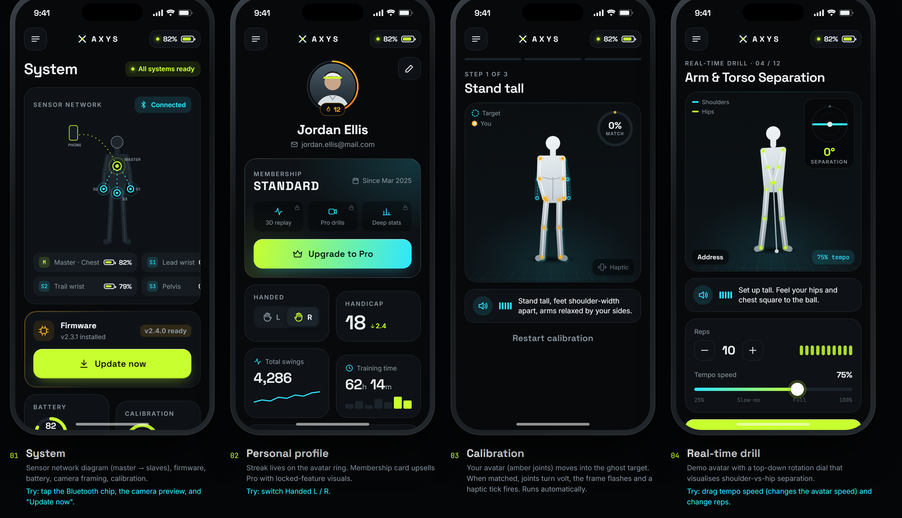
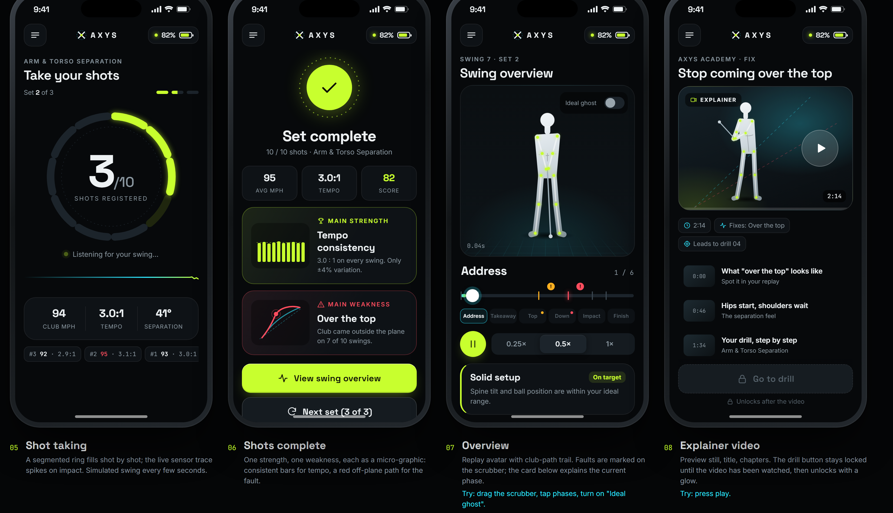

# AXYS — Premium Golf Training App · UI Concept

Interactive visual-direction prototype for the AXYS golf training app: 8 mobile screens, design system and button pressed-state concept.

**Live:** https://muradabbaszade.github.io/premium-golf-app-ui/




## Screens

1. System — sensor network, BLE status, firmware, battery, camera, calibration
2. Personal profile
3. Calibration — ghost avatar matching with haptic feedback
4. Real-time drill — Arm & Torso Separation
5. Shot taking
6. Shots complete — main strength / weakness
7. Overview — swing replay with 6-phase scrubber and faults
8. Explainer video — unlocks the drill when watched

## Run locally

Static site, no build step:

```bash
python -m http.server 5173
```

Then open http://localhost:5173.

## Deploy

Pushing to `main` deploys to GitHub Pages via `.github/workflows/pages.yml`.
